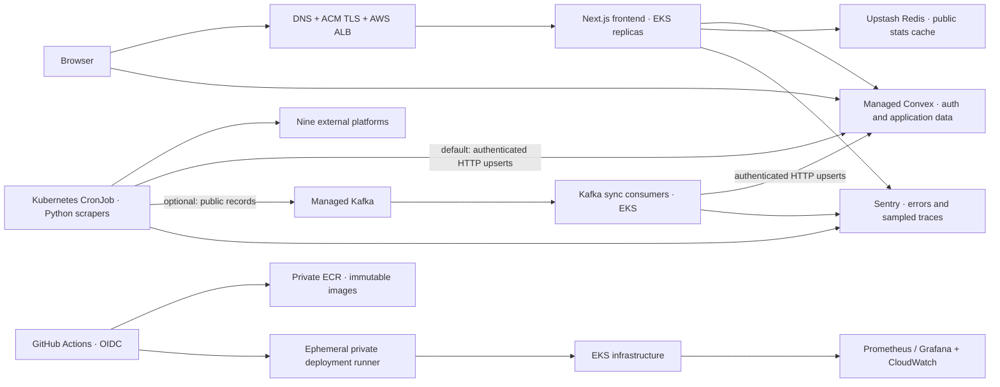

# HackkyHub production deployment guide

**Prepared: 30 September 2026 · Architecture: AWS EKS · Audience: project owner and deployment operator**

This guide deploys the actual HackkyHub repository: a Next.js frontend, frontend-owned Convex functions and authentication, an Upstash cache, and Python ingestion for nine hackathon platforms. It includes GitHub Actions, Docker, Terraform, Kubernetes, Sentry, infrastructure monitoring, and optional managed Kafka.

The repository now contains deployment templates and an optional Kafka worker. Cloud resources, provider accounts, DNS, production credentials, and live monitoring have **not** been provisioned. Follow the steps below in staging first. A successful local build is not evidence of production availability.

## 1. Architecture and deployment choices



| Component | Production role | Important constraint |
| --- | --- | --- |
| Next.js 16 / React 19 | Landing page, dashboard, profile, teams, public stats API | Requires a running Node server; use the standalone Docker build |
| Convex | Authoritative hackathons, user profiles, saved items, teams, authentication | Deploy **frontend/convex**; the older backend/convex schema is not the application schema |
| Redux Toolkit | Shared browser state and dashboard filters | Never treat browser state as authorization or authoritative storage |
| Upstash Redis | 60-second public dashboard statistics cache | Optional; failures fall back to Convex; keep credentials server-side |
| Python scrapers | Unstop, Devpost, MLH, Hack2Skill, Devfolio, Devnovate, Commudle, HackerEarth, HackCulture | Schedule one ingestion job per environment; provider layouts can change |
| Kafka | Optional buffering, retries and independently scalable consumers | Add after the direct HTTP ingestion path is stable |
| Sentry | Application error reports and sampled traces | Requires projects, DSNs, alert routing and a staging verification |
| Prometheus/Grafana/CloudWatch | Cluster health, job freshness, dashboards and operational logs | Sentry does not replace infrastructure monitoring |

Use separate staging and production Convex deployments, Redis databases, Kafka topics/credentials, AWS secrets and GitHub environments. Separate AWS accounts are preferable; the templates also support separate clusters in one account.

The example runs EKS nodes in private subnets across three availability zones. Production uses a NAT gateway per zone; staging can use one to reduce cost. The Kubernetes API is private. Budget for nodes, EKS, NAT, ALB, logs and managed services before applying Terraform. Kafka is optional and adds operating cost.

## 2. Files delivered with this guide

| Path from repository root | Purpose |
| --- | --- |
| `frontend/Dockerfile`, `backend/Dockerfile` | Frontend standalone image and ingestion/consumer image, running as user 10001 |
| `compose.yaml` | Local container smoke testing; ingestion runs only with the jobs profile |
| `.github/workflows/ci.yml` | Lint, types, tests, builds, dependency audits, Terraform validation and manifest rendering |
| `.github/workflows/release.yml` | Protected manual releases, OIDC, image scans, ECR publishing, Convex deployment and Kubernetes rollout |
| `.github/dependabot.yml` | Scheduled dependency update proposals |
| `infra/terraform/bootstrap` | Encrypted, versioned, private Terraform state storage |
| `infra/terraform/aws` | VPC, subnets, NAT, EKS, ECR, IAM and empty Secrets Manager containers |
| `infra/k8s/base` | Two frontend replicas, health probes, HPA, PDB, scheduled ingestion and egress policy |
| `infra/k8s/overlays/{staging,production}` | Per-environment namespaces and TLS ingress templates |
| `infra/k8s/external-secrets.example.yaml` | Secrets Manager to namespace secrets through IRSA |
| `infra/k8s/kafka-worker.example.yaml` | Optional Kafka consumer deployment |
| `infra/observability` | Prometheus values, ingestion alerts and Next.js Sentry activation templates |
| `backend/app/telemetry.py` | Optional Python Sentry initialization with request metadata scrubbing |
| `backend/app/kafka_transport.py`, `backend/scripts/kafka_to_frontend.py` | Optional producer and consumer; explicit commits and dead-letter delivery |
| `SECURITY_REVIEW.md` | Security changes, evidence and remaining verification limits |

Examples deliberately contain placeholders. Replace the public domain, ACM certificate ARN, repository identity, cloud account, Kubernetes version and release images before applying them. Do not commit `.env`, `.secrets`, Terraform state, plans or credentials.

## 3. Prerequisites and release hygiene

Install Git, Node.js 22, Python 3.12, Docker with a running Linux engine, AWS CLI v2, Terraform 1.13.5, kubectl compatible with your selected EKS version, Kustomize and Helm. This guide's commands use a Bash shell from the repository root unless noted; on Windows use WSL or adapt shell syntax.

Create an AWS operator role through your organization's normal MFA/SSO process. Avoid account-root and permanent developer access keys. Register GitHub's OIDC provider once in the account: issuer `https://token.actions.githubusercontent.com`, audience `sts.amazonaws.com`. The application role trusts only the configured repository and its selected GitHub environment. See [GitHub's AWS OIDC guidance](https://docs.github.com/en/actions/how-tos/secure-your-work/security-harden-deployments/oidc-in-aws).

Before enabling production releases:

1. Protect `main`, require the CI workflow, require review for workflow/infrastructure/auth changes, and prohibit force pushes.
2. Create GitHub environments `staging` and `production`; allow releases from `main` only. Require an independent production reviewer.
3. Pin GitHub Actions to reviewed full commit SHAs and Docker base/scanner images to reviewed SHA256 digests. The included version tags are a starting point, not immutable supply-chain pinning. Keep Dependabot updates reviewed.
4. Generate and commit a Python lock file under Linux/Python 3.12. The current requirements are ranges, so do not call them reproducible. For example, use a reviewed `pip-tools` release and `pip-compile --generate-hashes --output-file requirements-ops.lock requirements-ops.txt`; then change Docker and CI to `pip install --require-hashes -r requirements-ops.lock`. Resolve any dependency audit failures before release.
5. Commit the supplied Terraform provider lock files and `frontend/package-lock.json`; CI uses `npm ci`. Store generated SBOMs, scan results, rendered manifests and image digests with each release.
6. Choose a currently supported EKS Kubernetes version in `ap-south-1` and a compatible set of controller/chart versions. The `kubernetes_version` example is intentionally a placeholder. Do not choose a version solely because it appears in an old tutorial.

## 4. Configure Convex and authentication first

Create distinct staging and production deployments in the Convex dashboard. Work from `frontend`, using the deployment's own deploy key. Never deploy the legacy `backend/convex` functions onto these deployments.

```bash
cd frontend
npm ci
# Set CONVEX_DEPLOY_KEY securely in the shell or protected CI environment.
npx convex deploy --yes
# For the production deployment selected by your Convex project:
npx @convex-dev/auth --prod
cd ..
```

The Convex Auth setup generates deployment signing configuration. Confirm `JWT_PRIVATE_KEY` and `JWKS` exist in the intended deployment. Set `SITE_URL` to the exact public application origin, for example `https://hackkyhub.example`; this is distinct from Convex's built-in `CONVEX_SITE_URL`, which is a `https://...convex.site` URL. Do not overwrite the latter with localhost. Use the documented environment-specific workflow for staging, which may use a separate Convex project. [Convex Auth production setup](https://labs.convex.dev/auth/production) explains the production configuration.

Configure these values **in the Convex deployment environment**, not in the frontend Docker image:

| Variable | Purpose |
| --- | --- |
| `SITE_URL` | Application origin used for redirects |
| `JWT_PRIVATE_KEY`, `JWKS` | Signing configuration generated by Convex Auth |
| `AUTH_GITHUB_ID`, `AUTH_GITHUB_SECRET` | Environment-specific GitHub OAuth application |
| `AUTH_GOOGLE_ID`, `AUTH_GOOGLE_SECRET` | Environment-specific Google OAuth application |
| `AUTH_RESEND_KEY`, `AUTH_EMAIL_FROM` | Email OTP delivery; use a verified sending domain |
| `SCRAPER_SYNC_TOKEN` | Long random ingestion bearer token; must match the scraper secret |

OAuth callback URLs are on the deployment's Convex HTTP domain:

```text
https://<staging-or-production>.convex.site/api/auth/callback/github
https://<staging-or-production>.convex.site/api/auth/callback/google
```

Verify email-domain ownership and SPF/DKIM/DMARC, OAuth consent settings, callback allowlists and sender reputation. Test sign-in, logout, expired OTPs, account isolation and private dashboard routes in staging. Use dedicated test accounts; avoid real user data.

## 5. Create runtime secrets and build variables

The only required public frontend build variable is `NEXT_PUBLIC_CONVEX_URL=https://<environment>.convex.cloud`. Next.js bakes public variables into browser assets; changing a Kubernetes environment variable cannot redirect an already-built browser bundle. Build separate staging and production images with the correct URL. [Convex custom hosting guidance](https://docs.convex.dev/production/hosting/custom) covers deployment and frontend build configuration.

Use AWS Secrets Manager JSON objects and External Secrets for Kubernetes. Terraform creates the secret containers but **does not write values**, keeping credentials out of Terraform state. Populate them using the AWS console or a restricted local JSON file, never literal secrets in shell history.

Frontend secret `hackkyhub/<environment>/frontend`:

```json
{
  "UPSTASH_REDIS_REST_URL": "https://<database>.upstash.io",
  "UPSTASH_REDIS_REST_TOKEN": "<secret>",
  "APP_ENV": "staging",
  "APP_RELEASE": "<release-identifier>"
}
```

Scraper secret `hackkyhub/<environment>/scraper`:

```json
{
  "FRONTEND_SYNC_URL": "https://<environment>.convex.site/api/hackathons/sync",
  "SCRAPER_SYNC_TOKEN": "<same-value-as-Convex>",
  "APP_ENV": "staging",
  "APP_RELEASE": "<release-identifier>",
  "SENTRY_DSN": "<optional-ingestion-project-dsn>"
}
```

```bash
# Replace the secret name and use an ignored, access-restricted file.
aws secretsmanager put-secret-value \
  --secret-id hackkyhub/staging/scraper \
  --secret-string file://.secrets/scraper.json
```

Create one Upstash database per environment close to the frontend region; copy REST URL/token into the frontend secret. This cache holds public statistics, not session credentials or authoritative data. Missing credentials bypass caching. Redis timeout is bounded and failed writes are best effort. Confirm repeated `/api/dashboard/stats` requests produce a cache HIT when configured, and remain available when Redis is temporarily unreachable.

For optional Kafka add its bootstrap servers and API credentials only to the scraper secret. Give producer and consumer separate credentials in production by splitting their runtime secrets and updating the worker manifest. Never expose provider tokens with a `NEXT_PUBLIC_` prefix.

## 6. Build and test Docker locally

Create ignored `.secrets/frontend.env` and `.secrets/scraper.env` with the corresponding variables, then:

```bash
export NEXT_PUBLIC_CONVEX_URL=https://<staging>.convex.cloud
docker compose config --no-env-resolution
docker compose build
docker compose up -d frontend
curl --fail http://localhost:3000/api/health
curl --fail http://localhost:3000/api/dashboard/stats
docker compose --profile jobs run --rm ingest python scripts/sync_to_frontend.py --dry-run
# This next command writes public hackathon records to the selected deployment.
docker compose --profile jobs run --rm ingest
docker compose down
```

The frontend image uses Next.js standalone output. Runtime containers are non-root, drop capabilities and use read-only root filesystems with bounded writable temporary/cache locations. The ingestion image can include Chromium for providers needing rendering. Confirm a representative rendered provider works with the runtime user and memory limits.

Do not run `uvicorn --reload` in production. The selected architecture invokes the ingestion CLI through a CronJob; it does not expose the legacy FastAPI scraper administration service. If you separately deploy that service, isolate it privately, require its bearer credential, and remove or disable its in-process scheduler before using multiple replicas. Otherwise replicas can duplicate scheduled work.

## 7. Provision Terraform state and AWS infrastructure

The AWS provider is pinned to 6.66.0 and the EKS module to 21.26.0. Terraform initialization downloads these dependencies; review upgrades through CI. State is sensitive even without explicit secret values.

Bootstrap encrypted S3 state storage using an authenticated operator:

```bash
terraform -chdir=infra/terraform/bootstrap init
terraform -chdir=infra/terraform/bootstrap plan \
  -var='region=ap-south-1' \
  -var='state_bucket_name=<globally-unique-private-bucket>' \
  -out=bootstrap.tfplan
# Review the plan and cost before applying.
terraform -chdir=infra/terraform/bootstrap apply bootstrap.tfplan
```

Record the bucket and KMS key outputs. The initial bootstrap state is local: securely retain it, then add an S3 backend block and migrate it with `terraform init -migrate-state` to a dedicated `bootstrap/terraform.tfstate` key. Do not delete or commit the local state. Restrict state access to the infrastructure operator and CI roles, and include permission to manage the S3 `.tflock` object.

Create an ignored backend configuration file, for example `infra/terraform/aws/staging.backend.hcl`:

```hcl
bucket       = "<state-bucket>"
key          = "hackkyhub/staging/terraform.tfstate"
region       = "ap-south-1"
encrypt      = true
kms_key_id   = "<state-kms-key-arn>"
use_lockfile = true
```

Use S3 lockfile permissions and state versioning as described in [Terraform's S3 backend documentation](https://developer.hashicorp.com/terraform/language/backend/s3).

Copy `staging.tfvars.example` to `staging.tfvars`; replace every placeholder. Verify `github_repository` matches the actual owner/repository and `operator_role_arn` is your SSO/operator IAM role. Use distinct state keys, CIDRs and clusters for production.

```bash
terraform -chdir=infra/terraform/aws init -reconfigure -backend-config=staging.backend.hcl
terraform -chdir=infra/terraform/aws fmt -check
terraform -chdir=infra/terraform/aws validate
terraform -chdir=infra/terraform/aws plan -var-file=staging.tfvars -out=staging.tfplan
terraform -chdir=infra/terraform/aws apply staging.tfplan
terraform -chdir=infra/terraform/aws output
```

Production repeats this process with its own backend file and `production.tfvars`. Apply reviewed plans through an infrastructure operator; the application release role intentionally cannot provision infrastructure. Never run Terraform destroy as an application rollback. State storage, ECR and runtime secret containers have destruction safeguards.

Terraform creates private API access and an outbound-only deployment-runner security group. Provision an ephemeral Linux runner in a returned private subnet and attach `deploy_runner_security_group_id`; use SSM rather than inbound SSH. Its VPC connection permits the Kubernetes API, and GitHub OIDC supplies temporary deployment credentials. Configure the runner label `hackkyhub-deploy` and restrict it to protected release workflows. Install AWS CLI, kubectl, Kustomize, Node 22 and Git on its reviewed runner image. Do not execute fork/PR code on this privileged runner.

## 8. Bootstrap cluster controllers, TLS and secrets

Run these operator steps from a host connected to the private VPC:

```bash
aws eks update-kubeconfig --name hackkyhub-staging --region ap-south-1
kubectl apply -f infra/k8s/namespaces.yaml
```

Install and version-pin the following cluster components using their official charts and scoped IAM roles. These are **operator bootstrap steps**, not resources created by the application templates:

| Component | Required configuration |
| --- | --- |
| AWS Load Balancer Controller | EKS-compatible chart; IRSA and official controller IAM policy; correct region/VPC; no broad application-role AWS permissions |
| Metrics Server | Needed for the frontend CPU HPA; verify `kubectl top pods` |
| External Secrets Operator | Stable v1 CRDs; provider IRSA; scoped secret-reader IAM role from Terraform |
| EBS CSI driver | IRSA and gp3 StorageClass for persistent Prometheus/Grafana storage |
| Cluster Autoscaler or Karpenter | Needed to add nodes when the HPA creates pending pods; configure IAM and discovery tags explicitly |
| Log collector | Fluent Bit/CloudWatch or an equivalent managed collector; retention and sensitive-field filtering |

The node group's maximum size alone does **not** install node autoscaling. HPA adjusts pods; a separately configured node autoscaler must adjust capacity. Validate pod spreading and loss of a node/AZ under staging load. See [EKS autoscaling guidance](https://docs.aws.amazon.com/eks/latest/best-practices/cas.html).

Request an ACM certificate in the ALB's AWS region, validate domain ownership, and replace the certificate ARN and hostname in each ingress overlay. Use HTTPS redirects and a DNS alias to the resulting ALB. Apply an AWS WAF web ACL at the ALB for managed rules and suitable public HTTP rate limits; test it before enforcing blocks. ALB rules do not protect the separate Convex public domain: configure authentication-provider limits and review Convex endpoint exposure separately. [Controller ingress annotations](https://kubernetes-sigs.github.io/aws-load-balancer-controller/latest/guide/ingress/annotations/) document TLS and target settings.

Edit a copy of `infra/k8s/external-secrets.example.yaml` for each environment:

1. Set its application namespace and region.
2. Replace the role ARN with Terraform's `runtime_secrets_role_arn` for that environment.
3. Set both remote secret paths to that environment.
4. Apply it and wait for both ExternalSecrets to report Ready. Avoid printing their values.

```bash
kubectl apply -f <edited-external-secrets.yaml>
kubectl get externalsecret -n hackkyhub-staging
```

The Terraform IAM trust restricts the role to `runtime-secrets` in its application namespace; applications have service-account token mounting disabled. [External Secrets AWS authentication](https://external-secrets.io/latest/provider/aws-access/) describes IRSA configuration. Secret environment variables are read at process start: after rotation, restart affected deployments and verify the next ingestion job. Align the Convex ingestion token rotation with scraper rotation to avoid an authentication gap.

The application NetworkPolicy permits DNS, public IPv4 HTTPS and Kafka TLS traffic, while excluding private/link-local destinations. Confirm your networking plugin enforces policies. Application-level scraper validation also rejects untrusted/private targets. Add narrowly scoped exceptions only for an actual trusted dependency, such as an approved rendering CDN; never disable destination checks to make a scraper succeed.

## 9. Configure and run CI/CD

Add these GitHub environment variables for **both** environments:

| Variable | Value |
| --- | --- |
| `AWS_REGION` | e.g. `ap-south-1` |
| `AWS_ROLE_ARN` | Terraform `github_role_arn` |
| `FRONTEND_REPOSITORY`, `SCRAPER_REPOSITORY` | Full ECR repository URLs from Terraform |
| `EKS_CLUSTER_NAME` | Environment's cluster name |
| `NEXT_PUBLIC_CONVEX_URL` | Environment's `.convex.cloud` URL |
| `PUBLIC_URL` | Exact HTTPS application origin |

Add the environment secret `CONVEX_DEPLOY_KEY` for the matching frontend Convex deployment. Source-map upload tokens are added only after the Sentry activation steps below. No permanent AWS access keys are needed.

The included pipeline performs:

```text
PR / main commit
  → lint + type checks + frontend tests + production build
  → backend tests + compile checks + dependency audits
  → Terraform formatting/validation + Kubernetes/Compose rendering

Protected manual Release from main
  → run the same CI gates
  → build environment-specific images
  → block HIGH/CRITICAL image vulnerabilities
  → publish immutable commit/run-tagged ECR images
  → deploy additive frontend-owned Convex changes
  → render/apply Kubernetes release from the private runner
  → wait for readiness and check public health/stats
```

Release to staging first. Verify auth, user isolation, social-link saving/clearing, teams, all nine platform filters, activity heatmap, mobile navigation, theme toggle, loading transition and custom 404. Confirm ingestion inserts/updates through the authenticated endpoint and unauthorized calls return 401. Do not bypass a failed audit or smoke check by disabling it.

Record the commit SHA, deployment environment, image digests and previous image references. The current workflow uses unique immutable ECR tags; pin rendered release manifests to the resolved image digests for a stronger promotion record. Require the production reviewer to verify the same commit has passed staging. Staging and production frontend images are separate builds because their public Convex URLs differ.

The release deploys Convex before the frontend. Schema/API changes therefore need an **expand/contract** approach: add backward-compatible fields/endpoints, deploy clients, then remove old behavior only after old releases are retired. An automatic frontend rollback cannot safely reverse destructive database/schema changes.

## 10. Configure Sentry application monitoring

Create frontend and ingestion Sentry projects with staging/production environments. Assign a real alert recipient and test delivery. Use a release identifier matching the image/commit.

**Python:** the supplied CLI and Kafka consumer initialize Sentry only when `SENTRY_DSN` is set. The operations Docker dependencies include the SDK. Set DSN/environment/release in the scraper runtime secret. Unhandled ingestion/consumer failures report exceptions and exit nonzero; provider failures also report a warning. Zero valid records fail the ingestion job so that an apparently successful empty run cannot hide a total provider failure.

**Next.js:** activate the templates using `infra/observability/sentry/README.md`. Install and lock a reviewed `@sentry/nextjs` version, copy the client/server/instrumentation templates to `frontend`, and wrap the Next configuration with `withSentryConfig`. Pass public DSN/environment/release at image build time; pass server DSN at runtime. Upload source maps using a protected, scoped Sentry auth token through a BuildKit secret mount. Do not put that token in a build ARG, committed file or image layer. [Sentry's Next.js setup](https://docs.sentry.io/platforms/javascript/guides/nextjs/manual-setup/) covers the SDK hooks.

Start with 5% tracing and error capture, without session replay. The templates remove request/user metadata and browser breadcrumbs; review event contents to ensure OAuth tokens, OTPs, cookies, emails, invite codes and profile links are not captured. Add targeted safe breadcrumbs only if needed. Python request data is similarly scrubbed. [Sentry Python configuration](https://docs.sentry.io/platforms/python/) describes SDK controls.

Test one deliberate staging browser exception and one worker exception, confirm source-map symbolication, confirm alert delivery, then remove the test trigger. Convex runs outside Next.js: its function errors and quota/latency signals must be monitored in Convex as well. Next.js Sentry instrumentation does not automatically instrument hosted Convex functions.

## 11. Configure infrastructure monitoring and alerting

Install a reviewed version of `kube-prometheus-stack` in `monitoring`, with the supplied example values. Create the `grafana-admin` secret using your secret manager, provision gp3 storage and configure retention. Keep Grafana private through VPN/SSO or port-forwarding. Do not expose default admin credentials or unauthenticated metrics publicly.

```bash
helm repo add prometheus-community https://prometheus-community.github.io/helm-charts
helm repo update
helm upgrade --install monitoring prometheus-community/kube-prometheus-stack \
  --version <reviewed-compatible-chart-version> \
  --namespace monitoring --create-namespace \
  -f infra/observability/prometheus-values.example.yaml
kubectl apply -f infra/observability/alerts.example.yaml
```

Connect Alertmanager to the team's on-call channel using secret-backed receiver configuration. The examples include failed ingestion, ingestion freshness over 12 hours and no available frontend replicas. Validate the metrics and rule selectors against the installed chart version. Add blackbox/synthetic probes; `/api/health` deliberately tests process liveness only and does not exercise authentication or dependencies.

| Signal | Initial alert / dashboard |
| --- | --- |
| Public site availability | Probe HTTPS every minute from outside AWS; page if continuously failing for 2 minutes |
| ALB errors / latency | 5xx over 1% for 5 minutes; p95 latency above the team's measured baseline |
| Frontend | Error rate, readiness, restarts/OOMs, CPU, memory and replica availability |
| Authentication | Staging synthetic sign-in; production provider errors and unusual failure rate without logging credentials |
| Ingestion | Failed CronJob, no successful run over 12 hours, per-provider counts suddenly dropping to zero |
| Convex | Function failures, latency, storage/usage limits and billing budget |
| Redis | Timeout/errors, cache hit ratio and Upstash quota/billing alerts |
| Kafka if enabled | Consumer lag/age, delivery errors, consumer restarts and any new DLQ events |
| Infrastructure | Pending pods, disk pressure, node/AZ loss, expiring TLS and failed secret refresh |

The current stats endpoint exposes event totals, not ingestion freshness. CronJob freshness is an operational starting point, not proof that every provider has fresh events. Preserve the CLI's provider summaries in collected job logs and build count-change alerts from those summaries or add dedicated metrics before promising provider-specific freshness SLAs.

Ship container logs to CloudWatch with an initial 30-day retention, appropriate access controls and budget alerts. EKS control-plane audit/authenticator logs are enabled by Terraform. Use Sentry for application errors, not as an unrestricted log archive. Avoid collecting bodies, authorization headers, OTPs or entire environments.

## 12. Optional Kafka setup

Start with the supplied HTTP CronJob. Enable Kafka when you need durable decoupling, controlled replay or more ingestion consumers. Prefer a managed service such as Confluent Cloud instead of running production brokers inside the application cluster.

1. Create a managed cluster in a nearby region. Require TLS and SASL authentication; the supplied client expects `SASL_SSL` and `PLAIN`.
2. Create `hackkyhub.hackathons.v1` with six partitions and seven-day retention. Create `hackkyhub.hackathons.dlq.v1` with three partitions and 30-day retention. Configure availability/replication according to the managed service's supported tier; do not claim a single-zone tier is multi-zone.
3. Producer credential: write main topic only. Consumer credential: read main topic and consumer group, write DLQ. Observability credentials should be read-only. Store all credentials server-side and rotate them.
4. Add bootstrap servers, API key/secret, topic, DLQ and group variables from `backend/.env.example` to the relevant runtime secrets. Set broker/topic message limits above the application's 512KB event cap.
5. Change the ingestion CronJob container command to `[python, scripts/sync_to_frontend.py, --transport, kafka]` and deploy an edited `kafka-worker.example.yaml` with environment namespace, immutable image and consumer-specific secret. Remove the previous direct HTTP scheduling path.
6. Test a normal event, temporary sync outage, malformed event, DLQ delivery failure and worker termination/restart in staging. Verify no source offset is committed before a successful sync or confirmed DLQ write.

The producer enables idempotent delivery and keys each public event by its hackathon URL. The consumer disables automatic commits, retries transient sync failures three times, and commits after a successful upsert or successful DLQ delivery. URL upserts make duplicate deliveries safe for record identity. This is **at-least-once delivery**, not cross-system exactly-once processing. [Confluent Python client documentation](https://docs.confluent.io/kafka-clients/python/2.15/overview.html) covers delivery and client configuration.

The current ingestion endpoint does not enforce event-version freshness. Replaying old data can overwrite newer public fields even when URL identity is stable. Do not automatically replay the DLQ: inspect records and timestamps, compare current data, and either re-scrape the source or implement a monotonic source-version guard before bulk replay. Only public hackathon metadata goes on topics; never user profiles, sessions, social links or credentials.

The supplied consumer deployment starts with two replicas and has no HTTP liveness endpoint. Kubernetes restarts crashed processes; use lag/heartbeat alerts to detect a live but stalled consumer. Add a reviewed Kafka-lag KEDA scaler if needed, bounded by partition count and Convex throughput. CPU HPA is not a reliable consumer-lag policy.

## 13. Security, data protection and performance before launch

Local hardening includes authentication on administrative writes, bounded sync payloads, server-derived user identity, private-destination checks for scraping, restricted CORS, secret-free browser bundles and basic browser security headers. This is not a completed independent penetration test. The Strix remote source scan remains pending explicit approval for private-source upload; see `SECURITY_REVIEW.md`.

Before accepting real users, verify:

- Two-account isolation for profile, saved events, activity and team operations; anonymous mutation rejection; auth/logout/session expiry across devices.
- OAuth/OTP abuse protection and provider limits; OTP sender verification; WAF rules on the application origin; limits on separately exposed Convex HTTP actions.
- Social links reject executable schemes and inappropriate hosts; all external links have appropriate opener protection.
- No secret values in public build variables, repository history, image layers, logs, source maps or Terraform state. Rotate anything previously exposed.
- Destination guards and network policies actually block private/link-local redirects under the deployed browser/network runtime.
- A full Content Security Policy tested with Convex/auth and the site's animations. Existing CSP restricts framing/objects/base URLs; it is not a complete script allowlist. Add HSTS only after validating HTTPS across intended subdomains.
- Privacy policy, data retention/deletion process, consent where needed, least-privilege operator access and MFA on all providers.

Run a measured staging load test using a reviewed tool such as k6. Exercise real read paths, login with test accounts, dashboard navigation and ingestion concurrently. Set initial operating objectives such as 99.9% public availability and a measured p95 API budget, then confirm them under load. These are proposed objectives, not achieved guarantees. Check Convex throughput and external provider quotas before raising replica counts.

Inspect mobile landing load, reduced-motion behavior, animation frame buffering, static asset caching and page weight. Put a CDN/WAF in front of the ALB if needed; preserve Next.js dynamic/auth semantics and never publicly cache personalized responses.

## 14. Backups and disaster recovery

Convex is the source of truth. Use the plan's supported backup/export options and verify restore procedures. Schedule an authenticated export of the **frontend production deployment** to encrypted, access-restricted storage; do not include deploy keys in the backup. Check your installed CLI's `convex export --help` before automating an export. For example, from `frontend`:

```bash
npx convex export --prod --path ../.secrets/convex-backup.zip
# Upload through a restricted backup role to a private KMS-encrypted S3 bucket.
aws s3 cp ../.secrets/convex-backup.zip s3://<private-backup-bucket>/<dated-object> \
  --sse aws:kms --sse-kms-key-id <backup-kms-key>
```

Use separate backup IAM roles, versioning and lifecycle retention, with daily exports as an initial policy and a monitored completion signal. Verify whether file storage is included and configure it if the application begins using it. Back up infrastructure configuration, approved release manifests, provider configuration and secret recovery procedures separately. Upstash public-stat cache can be rebuilt; it is not a user-data backup. Kafka retention is not a Convex backup.

An initial daily-export recovery target is **RPO up to 24 hours**, with **RTO four hours as a goal to test**. Choose more frequent/provider-supported recovery if that is insufficient. Perform a quarterly restore drill into an isolated staging deployment, including auth configuration and a user-account check. Do not import/replace production data without an incident-specific, reviewed recovery plan and verified target deployment.

## 15. Rollback and incident runbook

Application rollback restores known-good images, not Terraform state or database contents:

```bash
# Use recorded known-good image digests and the intended namespace.
kubectl set image deployment/frontend frontend=<previous-frontend-image@sha256:digest> \
  -n hackkyhub-production
kubectl rollout status deployment/frontend -n hackkyhub-production --timeout=300s
kubectl set image cronjob/ingestion ingestion=<previous-scraper-image@sha256:digest> \
  -n hackkyhub-production
```

For Kafka also update the consumer Deployment. Restore the release overlay/record so a later apply does not reintroduce the failing image. `kubectl rollout undo` can restore the previous frontend revision, but does not update a CronJob and cannot reverse Convex changes. Keep deployed database contracts backward-compatible.

| Incident | First action | Recovery evidence |
| --- | --- | --- |
| Broken frontend release | Roll back frontend image and inspect errors | Health + auth + dashboard checks pass |
| Convex outage or bad function deployment | Check provider status/logs; use approved compatible function release | Reads, private writes and auth succeed |
| Redis failure | Verify Convex fallback; repair/rotate cache credentials | Stats remain available and cache recovers |
| Provider scraper change | Inspect per-provider summaries; disable/fix only that path | A dry run yields valid source records |
| Token compromise | Revoke/rotate at provider and consumers, review logs | Old token rejected; new authorized requests succeed |
| Bad ingestion batch | Suspend CronJob/consumer before further writes; assess affected URLs | Reviewed correction or verified recovery |
| Growing Kafka lag / DLQ | Check sync errors, credentials and broker health before scaling | Lag age falls; DLQ cause fixed |
| Cluster capacity incident | Check pending pods/node health/autoscaler limits | Healthy replicas distributed across capacity |

After recovery, record timeline, impact, root cause and one concrete prevention action. Preserve evidence without copying secrets into incident reports.

## 16. Launch checklist and verification status

- [ ] Every placeholder replaced; production resources and DNS ownership reviewed.
- [ ] Dependencies/actions/images pinned and all CI/audit/image-scan gates pass.
- [ ] Docker images build and run with read-only filesystems and the runtime user.
- [ ] Terraform plan reviewed, state securely migrated, production costs approved.
- [ ] Private deployment runner, controllers, External Secrets and node autoscaling verified.
- [ ] Production Convex auth/provider configuration matches the frontend build URL.
- [ ] TLS redirects, security headers, WAF and synthetic probes verified.
- [ ] All nine providers tested; a scheduled ingestion run succeeds; failures alert.
- [ ] Sentry browser/worker alerts and source maps verified; sensitive event data absent.
- [ ] Optional Kafka delivery, retry, DLQ and consumer-restart tests pass if enabled.
- [ ] Mobile/accessibility/theme checks and staging load test pass.
- [ ] Restore drill and image rollback succeed; on-call ownership is assigned.
- [ ] Production release approved after the same commit's staging verification.

Local checks are recorded in `docs/VALIDATION.md`. Infrastructure rendering and validation do not contact an AWS account or prove cloud permissions, capacity, controllers, credentials or availability. Complete the unchecked launch items before describing the live service as production ready.
